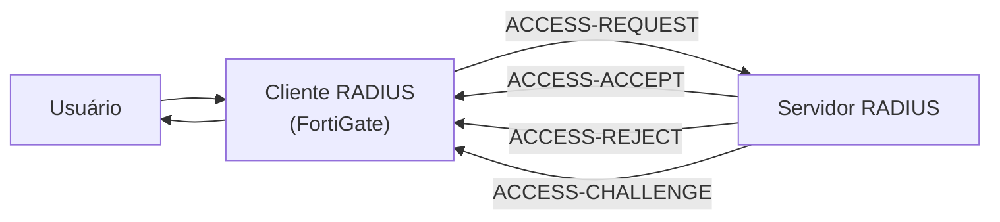

---
tags:
  - fortinet
  - fortigate
  - autenticacao
  - ldap
  - radius
---

# Autenticação remota no FortiGate

## Conceito

Na autenticação remota, as contas ficam armazenadas em um servidor externo. O FortiGate consulta esse servidor para validar as credenciais ou para incluir usuários/grupos remotos em grupos de firewall.

A apostila cita os seguintes métodos e serviços:

- LDAP
- RADIUS
- POP3
- TACACS+

---

## LDAP

### Conceito

**LDAP** é um protocolo usado para consultar e manter informações em serviços de diretório distribuídos. Entre os diretórios que utilizam LDAP estão:

- Microsoft Active Directory.
- Samba.

Um diretório pode armazenar informações como usuários, grupos, departamentos, senhas e e-mails.

### Portas

- **LDAP:** TCP 389.
- **LDAPS:** TCP 636.

LDAPS oferece uma conexão protegida por TLS. Para utilizá-lo, é necessário configurar o serviço seguro no servidor e importar/configurar o certificado correspondente no FortiGate.

### Estrutura do diretório

A estrutura LDAP é hierárquica, como uma árvore. Uma entrada é identificada por atributos, por exemplo:

- `dc` — componente do domínio.
- `ou` — unidade organizacional.
- `cn` — nome comum.
- `uid` — identificador do usuário.
- `sAMAccountName` — nome de conta usado com frequência no Active Directory.

Para o domínio `abc.com`, o DN da raiz pode ser:

`dc=abc,dc=com`

Exemplo de estrutura:


> No Obsidian, cole o bloco Mermaid completo e visualize a nota em modo de leitura ou pré-visualização.

### Identificador do usuário

O identificador comum padrão pode retornar o nome completo do usuário, em vez do nome de login. Por isso, o material recomenda avaliar o uso de:

- `uid`
- `sAMAccountName`

### Bind

O **bind** é a operação pela qual o servidor LDAP autentica uma conexão ou usuário.

A apostila recomenda o tipo **Regular** para realizar consultas com uma conta autenticada e de permissões mínimas. Evite usar uma conta com privilégios excessivos, como Domain Admin, quando não for necessário.

### Teste pela CLI

```bash
diagnose test authserver ldap <server_name> <username> <password>
```

Substitua os valores entre `< >` pelos dados do servidor e do usuário de teste.

---

## RADIUS

### Conceito

**RADIUS** é um protocolo usado para serviços de **AAA**:

- **Authentication** — autenticação.
- **Authorization** — autorização.
- **Accounting** — registro/contabilização.

No cenário da apostila, o FortiGate atua como cliente RADIUS e envia solicitações ao servidor.

### Fluxo de autenticação



### Respostas do servidor

- **ACCESS-ACCEPT:** as credenciais foram aceitas.
- **ACCESS-REJECT:** as credenciais foram rejeitadas.
- **ACCESS-CHALLENGE:** o servidor solicita informação adicional, como outro código, token ou certificado. Pode ser usado em cenários de autenticação multifator.

> Nem todos os clientes RADIUS suportam o fluxo de `ACCESS-CHALLENGE`.

### Métodos de autenticação

A apostila cita:

- PAP
- MSCHAP2
- CHAP

Quando o método está como padrão, o FortiGate tenta, nesta ordem:

1. PAP
2. MSCHAP2
3. CHAP

### Teste pela CLI

```bash
diagnose test authserver radius <server_name> <scheme> <username> <password>
```

Substitua os valores entre `< >` pelos dados do servidor, método e usuário de teste.

### Configurando o servidor 

- Serviço para instalar
	- Network Policy and Access Services
		- Network Policy Server
			- RADIUAS Client and Servers
				- RADIUS Clients
			- Policies
				- Connection Request Policies
					- Client IPv4 Address
						- IP FortiGate
				- Network Policies
					- Client IPv4 Address
					- 12356

## Resumo

- **LDAP/LDAPS** consulta informações em diretórios, como Active Directory e Samba.
- **RADIUS** fornece serviços de autenticação, autorização e contabilização.
- A autenticação remota permite centralizar contas fora do FortiGate.
- Use contas de consulta com permissões mínimas e prefira conexões protegidas quando disponíveis.