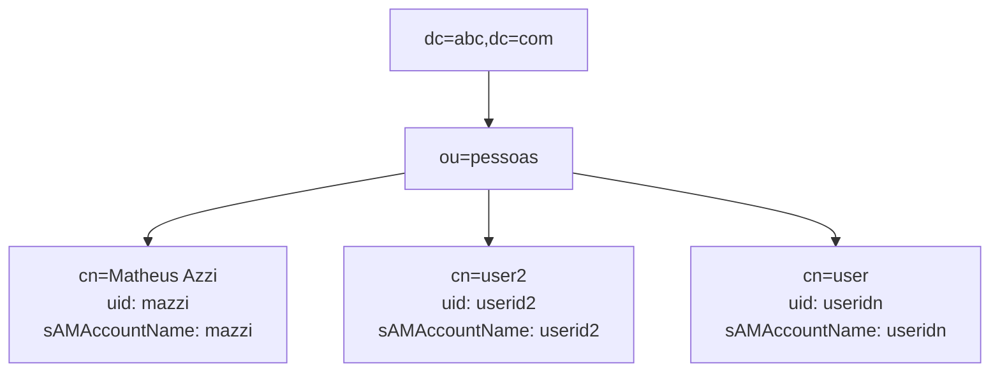
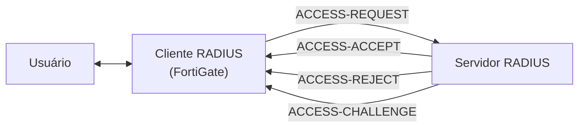

## LDAP

- Active Directory
- Samba

- LDAP 389, LDAPS 636

- Ex.
	- abc.com
		- dc=abc,dc=com

OU = Unidade Organizacional
CN = Grupo de Usuário
uid = Usuário e diversas outras

- Teste CLI
  
  diagnose test authserver ldap <dominio> <user> <senha>

## RADIUS

- ACCESS_ACCEPT
- ACCESS-REJECT
- ACCESS-CHALLENGE

- Método de autenticação
	- PAP
	- MSCHAP2
	- CHAP

diagnose test authserver radius <servidor> <metodo> <user> <senha>