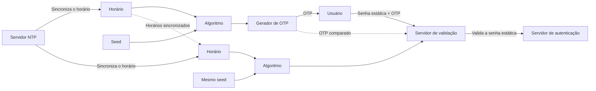

---
tags:
  - fortinet
  - fortigate
  - autenticacao
  - 2fa
  - fortitoken
  - otp
---

# 2FA e FortiToken

## Autenticação de dois fatores

A autenticação de dois fatores (**2FA**) aumenta a segurança ao exigir dois fatores independentes:

- **Algo que você sabe:** senha ou PIN.
- **Algo que você tem:** token ou certificado.

Assim, o conhecimento da senha, sozinho, não basta para concluir a autenticação quando o segundo fator também é exigido.

## OTP

**OTP** (*One-Time Password*) é uma senha de uso único. De acordo com a apostila, o FortiToken pode entregar OTP por diferentes meios, incluindo:

- FortiToken físico.
- FortiToken Mobile.
- E-mail ou SMS, quando configurados.
- FortiToken Mobile Push.

## Como o FortiToken gera o OTP

O OTP é calculado com base em:

- **Seed:** valor único, gerado aleatoriamente e que não muda a cada intervalo.
- **Horário:** deve ser obtido de um relógio confiável.
- **Algoritmo:** usa o seed e o horário para gerar o código.

O token e o servidor de validação precisam usar o mesmo seed e horários compatíveis para chegar ao mesmo OTP. Por isso, a apostila recomenda sincronizar o FortiGate e o dispositivo com um servidor NTP confiável.

## Etapas do fluxo

1. O token calcula um OTP com seu seed e horário.
2. O usuário informa a senha estática junto com o OTP.
3. O servidor de validação usa o seed e o horário para calcular o OTP esperado.
4. O servidor valida a senha estática e compara o OTP recebido com o calculado.
5. Se as verificações forem válidas, a autenticação pode ser aceita.

## Pontos importantes

- Mantenha o FortiGate e os dispositivos de token sincronizados com NTP.
- Um horário incorreto pode fazer com que o OTP não corresponda ao esperado.
- O segundo fator complementa a senha; não substitui a necessidade de proteger as credenciais.
- O FortiToken pode ser associado a usuários e, conforme a configuração, a administradores.

## Resumo

- 2FA exige dois fatores diferentes.
- O OTP é temporário e de uso único.
- FortiToken calcula o OTP usando seed, horário e algoritmo.
- A sincronização de horário é essencial para a validação funcionar.