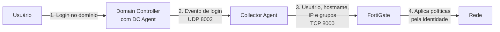
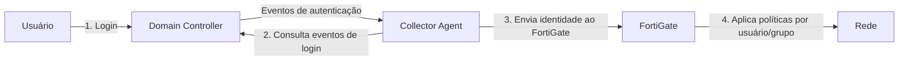
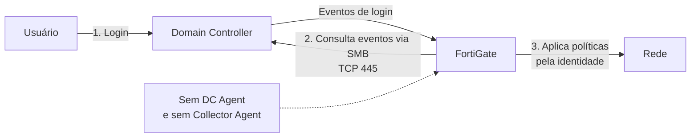

---
tags:
  - fortinet
  - fortigate
  - autenticacao
  - sso
  - fsso
---

# SSO e FSSO — Fortinet Single Sign-On

## Conceito de SSO

**SSO (Single Sign-On)**, ou login único, permite que um usuário já autenticado acesse diferentes aplicações ou recursos sem precisar inserir novamente suas credenciais em cada acesso.

O **FSSO (Fortinet Single Sign-On)** permite que o FortiGate identifique usuários autenticados no ambiente, normalmente no Active Directory, e aplique políticas de firewall baseadas na identidade e nos grupos aos quais pertencem.

O FSSO pode fornecer ao FortiGate informações como:

- Identidade do usuário.
- Endereço IP associado ao usuário.
- Grupos de usuários.
- Estação de trabalho, conforme o método de implantação.

Os grupos FSSO podem representar usuários individuais, grupos de usuários, unidades organizacionais (**OU**) ou combinações desses elementos.

## Autenticação passiva

O FSSO é um método de **autenticação passiva**:

- O usuário autentica-se normalmente no domínio.
- O FortiGate recebe ou consulta as informações de login.
- O usuário não precisa inserir novamente suas credenciais em um Captive Portal do FortiGate.
- As políticas podem permitir ou negar o acesso de acordo com o usuário ou grupo identificado.

O FSSO é comumente utilizado com serviços de diretório, como:

- Microsoft Active Directory.
- Novell eDirectory.

Ver também: [[341_Geral]] e [[321_Firewall_Policy]].

---

## Métodos de implantação

Para Microsoft Active Directory, a apostila apresenta três opções principais:

1. **DC Agent Mode**
2. **Polling Mode com Collector Agent**
3. **Polling Mode sem agente (Agentless)**

Para Novell eDirectory, é possível usar o modo com agente, que monitora os logins e encaminha as informações ao FortiGate.

### Comparação geral

| Característica | DC Agent Mode | Polling com Collector Agent | Polling sem agente |
|---|---|---|---|
| DC Agent instalado | Sim, em cada Domain Controller | Não | Não |
| Collector Agent | Sim | Sim | Não |
| Quem consulta o DC | DC Agent monitora os logins | Collector Agent | FortiGate |
| Complexidade de instalação | Maior | Menor | Menor |
| Reinicialização dos DCs | Necessária conforme a apostila | Não | Não |
| Escalabilidade | Maior | Menor que DC Agent | Menor |
| Recursos utilizados | Compartilhados com os DC Agents | Recursos do Collector Agent | CPU e RAM do FortiGate |
| Observação | Captura eventos de login | Pode ter atraso ou perder eventos, dependendo do método | Suporta apenas WinSecLog, conforme a apostila |

---

## 1. DC Agent Mode

O **DC Agent Mode** é descrito na apostila como o modo mais escalável e, para a maioria dos ambientes, o recomendado.

### Componentes

- **DC Agent:** instalado em cada Windows Domain Controller. O arquivo citado é `dcagent.dll`, localizado em `Windows\system32`.
- **Collector Agent:** instalado em um ou mais servidores Windows e responsável por processar as informações recebidas e encaminhá-las ao FortiGate.

### Responsabilidades do DC Agent

- Monitorar eventos de login nos Domain Controllers.
- Encaminhar os eventos ao Collector Agent.
- Realizar consultas DNS, comportamento que pode ser desativado.

### Responsabilidades do Collector Agent

- Verificar grupos dos usuários.
- Verificar estações de trabalho.
- Atualizar os registros de login no FortiGate.
- Enviar informações de domínio, como grupos de segurança e OUs.

### Fluxo de autenticação

1. O usuário autentica-se em seu computador contra um Domain Controller.
2. O DC Agent detecta o evento de login.
3. O DC Agent encaminha o evento ao Collector Agent.
4. O Collector Agent envia as informações ao FortiGate.
5. O FortiGate associa o usuário ao endereço IP e aplica as políticas correspondentes.



### Consulta DNS duplicada

O DC Agent pode realizar consultas DNS, e o Collector Agent pode consultar novamente para verificar se o endereço IP da estação mudou. Em alguns ambientes, essa resolução duplicada pode causar problemas.

A apostila indica que esse comportamento pode ser desativado criando a chave de registro:

- Caminho: `HKLM\Software\Fortinet\FSAE\dcagent`
- Chave: `donot_resolve`
- Tipo: `DWORD`
- Valor: `1`

Faça essa alteração somente quando necessário e seguindo os procedimentos de administração do ambiente Windows.

---

## 2. Polling Mode com Collector Agent

Nesse modo, o **Collector Agent** consulta periodicamente os Domain Controllers em busca de eventos de login.

- Não é necessário instalar o DC Agent.
- O Collector Agent é instalado em um servidor Windows.
- O Collector Agent consulta os DCs e encaminha os logins ao FortiGate.
- A instalação é menos complexa que a do DC Agent Mode.

### Fluxo

1. O usuário autentica-se no computador contra o Domain Controller.
2. O Collector Agent consulta periodicamente o DC para obter eventos de login.
3. O Collector Agent encaminha os dados ao FortiGate.
4. O FortiGate associa o usuário ao endereço IP e utiliza essa identidade nas políticas.



### Métodos de polling com agente

| Método | Funcionamento | Características |
|---|---|---|
| **NetAPI** | Consulta a função `NetSessionEnum`, em intervalos de aproximadamente 9 segundos ou menos | Rápido; mantém informações de sessão em memória; pode perder eventos se o DC estiver com muitos recursos ocupados |
| **WinSecLog** | Consulta os logs de segurança do DC, em intervalos de aproximadamente 10 segundos ou mais | Pode ter atraso, especialmente em redes lentas ou com DCs sobrecarregados; requer que os logs de eventos estejam ativos |
| **WMI** | O DC retorna eventos de login em intervalos de aproximadamente 3 segundos, e o Collector Agent os lê | Pode usar menos banda que WinSecLog, conforme a apostila; requer configuração e conectividade WMI |

> Os intervalos são valores aproximados apresentados no material. O comportamento pode variar de acordo com a configuração e a versão utilizada.

### Portas citadas para polling com agente

- **TCP 445** — SMB, método padrão indicado.
- **TCP 135**, **TCP 139** e **UDP 137** — alternativas mencionadas na apostila.

---

## 3. Polling Mode sem agente

No modo sem agente, o **próprio FortiGate consulta o Domain Controller**.

- Não é necessário instalar DC Agent.
- Não é necessário instalar Collector Agent.
- Os eventos de login precisam estar habilitados nos Domain Controllers.
- O FortiGate utiliza SMB para consultar os eventos.
- A apostila indica suporte apenas ao método **WinSecLog**, utilizando os IDs de evento **4768 e 4769**.
- O FortiGate não verifica as estações de trabalho.
- Esse modo consome CPU e memória do FortiGate.
- Tem menos funcionalidades que os modos com agentes.

### Fluxo

1. O usuário autentica-se no computador contra o Domain Controller.
2. O FortiGate consulta periodicamente o DC pelos eventos de login.
3. O FortiGate associa a identidade ao endereço IP e aplica as políticas.



---

## FSSO para Novell eDirectory

A apostila também menciona o suporte ao **Novell eDirectory**:

- Pode utilizar o modo **eDirectory Agent**.
- Pode utilizar API Novell ou configuração LDAP.
- O agente é instalado na rede Novell.
- O agente monitora os logins e encaminha as informações ao FortiGate.
- A função é semelhante à do Collector Agent no ambiente Windows AD.

---

## Requisitos adicionais

### DNS

O servidor DNS deve resolver corretamente os nomes das estações para seus endereços IP.

Isso é importante porque os eventos de login do Windows podem conter o **nome da estação**, e não seu endereço IP. O Collector Agent pode usar DNS para resolver o nome da estação em um IP.

### Verificação das estações de trabalho

Para verificar se o usuário ainda está conectado à estação, o Collector Agent pode consultar os computadores usando WMI.

A apostila destaca a necessidade de conectividade entre o Collector Agent ou FortiGate e as estações, incluindo:

- **TCP 445** — porta padrão citada.
- **TCP 139** — alternativa citada.

### Rede e capacidade

- Garanta que os firewalls intermediários liberem as portas necessárias ao método escolhido.
- A apostila recomenda pelo menos **64 Kbps de banda por Domain Controller**.
- Configure timeouts para remover sessões inativas em um período adequado.
- Mantenha o DNS atualizado quando uma estação trocar de endereço IP.
- Não configure o intervalo de verificação de estações como `0`.
- Inclua os grupos FSSO necessários nas políticas de firewall que utilizam autenticação passiva.

> As portas e os requisitos podem variar conforme o modo, a versão e a topologia. Confirme-os no ambiente antes de alterar regras de firewall.

---

## Uso do FSSO em políticas

Usuários e grupos identificados pelo FSSO podem ser usados como **origem** em políticas de firewall.

- A política pode referenciar usuários ou grupos FSSO.
- O FortiGate aplica a política quando reconhece a identidade e o tráfego corresponde aos demais critérios.
- A autenticação é transparente para o usuário quando o FSSO funciona corretamente.
- Se também houver políticas de autenticação ativa, organize as políticas passivas antes das ativas, conforme a lógica de autenticação do ambiente.

Ver também: [[321_Firewall_Policy]] e [[341_Geral]].

---

## Monitoramento no FortiGate

Na GUI, os usuários podem ser consultados em:

**Dashboard > Assets & Identities > Firewall Users**

A tela permite verificar usuários autenticados e, dependendo da visualização, informações como:

- Usuário.
- Endereço IP.
- Grupo.
- Duração.
- Volume de tráfego.
- Método de autenticação.

A visualização também permite desconectar usuários. A opção **Show all FSSO Logons** exibe logins FSSO.

---

## Logs do FSSO

O FortiGate gera logs relacionados a eventos de autenticação, como:

- Login.
- Logout.
- Autenticação NTLM.

Para registrar mais eventos, a apostila recomenda configurar o nível mínimo de log como **Notification** ou **Information**.

No Collector Agent, podem ser configurados:

- Nível de log.
- Tamanho máximo do arquivo de log.
- Registro de eventos de login.
- Visualização de usuários e eventos monitorados.
- Domínios monitorados.
- Intervalos de verificação e timeout.

---

## Troubleshooting e comandos CLI

### Conferir o status da conexão do agente

```bash
diagnose debug authd fsso server-status
```

Mostra o status da conexão entre o FortiGate e o agente FSSO.

### Comandos `diagnose debug authd fsso`

```text
diagnose debug authd fsso <comando>
```

| Comando | Função |
|---|---|
| `filter` | Define filtros usados para listar ou limpar logins |
| `list` | Mostra os usuários atualmente logados |
| `refresh-groups` | Atualiza o mapeamento de grupos |
| `summary` | Mostra um resumo dos usuários logados |
| `clear-logons` | Apaga os registros de login em cache |
| `refresh-logons` | Ressincroniza a base de logins |
| `show-address` | Mostra endereços dinâmicos FSAE |
| `server-status` | Mostra o status da conexão com o agente FSSO |

Exemplos:

```bash
diagnose debug authd fsso list
diagnose debug authd fsso summary
diagnose debug authd fsso server-status
diagnose debug authd fsso refresh-groups
```

### Comandos de autenticação do firewall

```bash
diagnose firewall auth list
diagnose firewall auth filter
diagnose firewall auth clear
diagnose firewall auth mac
diagnose firewall auth ipv6
```

| Comando | Função |
|---|---|
| `diagnose firewall auth list` | Lista usuários autenticados |
| `diagnose firewall auth filter` | Filtra por grupo, ID ou outro critério disponível |
| `diagnose firewall auth clear` | Limpa os usuários correspondentes ao filtro aplicado |
| `diagnose firewall auth mac` | Mostra usuários autenticados por MAC |
| `diagnose firewall auth ipv6` | Mostra usuários autenticados IPv6 |

> Use filtros com atenção antes de limpar registros de autenticação.

### Polling

```bash
diagnose debug fsso-polling detail
diagnose debug fsso-polling refresh-user
```

- `detail` exibe informações detalhadas sobre as consultas do FortiGate aos Domain Controllers, incluindo status e resultados do polling.
- `refresh-user` atualiza as informações de usuários do polling.

### Captura de pacotes para TCP 445

```bash
diagnose sniffer packet any 'host <ip_address> and tcp port 445'
```

Substitua `<ip_address>` pelo endereço IP do Domain Controller. O comando ajuda a verificar se há tráfego SMB entre o FortiGate e o DC.

### Debug do daemon FSSO

```bash
diagnose debug application fssod -1
diagnose debug enable
```

Para parar o debug:

```bash
diagnose debug disable
diagnose debug reset
```

> O debug pode gerar muitas mensagens. Ative-o durante o diagnóstico e desative-o após a coleta das informações necessárias.

### Atualizar a base FSSO

A apostila também apresenta:

```bash
execute fsso refresh
```

Esse comando atualiza as informações de grupos FSSO.

### Exibir usuários FSSO

```bash
diagnose debug authd fsso list
```

Exibe informações de usuários identificados, como nome, grupo, IP e estação de trabalho, quando disponíveis.

---

## Roteiro de troubleshooting

1. **Verifique a conexão com o Collector Agent:**
   ```bash
   diagnose debug authd fsso server-status
   ```

2. **Confira se os usuários estão registrados no FortiGate:**
   ```bash
   diagnose debug authd fsso list
   ```

3. **Confira os usuários autenticados:**
   ```bash
   diagnose firewall auth list
   ```

4. **Verifique o status do polling, se esse modo estiver sendo usado:**
   ```bash
   diagnose debug fsso-polling detail
   ```

5. **Verifique a conectividade SMB com o Domain Controller:**
   ```bash
   diagnose sniffer packet any 'host <ip_address> and tcp port 445'
   ```

6. **Atualize o mapeamento de grupos, se necessário:**
   ```bash
   diagnose debug authd fsso refresh-groups
   ```

7. **Use o debug do daemon para investigar erros:**
   ```bash
   diagnose debug application fssod -1
   diagnose debug enable
   ```

8. **Desative o debug ao concluir:**
   ```bash
   diagnose debug disable
   diagnose debug reset
   ```

9. **Revise DNS, portas, eventos de login e verificações das estações de trabalho.**

---

## Resumo

- **FSSO** identifica usuários autenticados no domínio e permite políticas baseadas em usuário e grupo, sem exigir novo login no FortiGate.
- No **DC Agent Mode**, o DC Agent monitora os logins e os envia ao Collector Agent.
- No **Polling com Collector Agent**, o coletor consulta os DCs.
- No **Polling sem agente**, o FortiGate consulta diretamente os DCs por SMB/TCP 445.
- O DNS precisa resolver corretamente os nomes das estações para IPs.
- O modo escolhido determina quais agentes, portas e recursos são necessários.
- Os comandos principais para troubleshooting são `diagnose debug authd fsso`, `diagnose debug fsso-polling detail`, `diagnose firewall auth` e o sniffer de TCP 445.