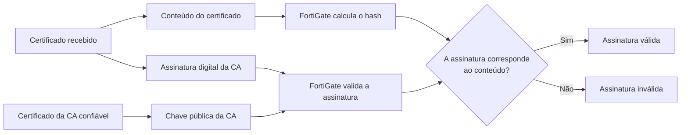

---
tags:
  - fortinet
  - fortigate
  - certificados
  - tls
  - ssl-inspection
  - ipsec
---

# Certificados digitais, TLS e inspeção SSL

## Visão geral

Certificados digitais são usados pelo FortiGate para **identificar usuários e dispositivos**, validar confiança e proteger comunicações. Também podem ser usados em conexões VPN, na interface administrativa, na inspeção SSL e como segundo fator de autenticação.

Nesta nota:

- **TLS** protege comunicações de aplicações.
- **IPsec** protege tráfego em nível de rede e é comum em VPNs.
- **X.509v3** é o padrão de certificado usado pelo FortiGate.
- **CA** é a Autoridade Certificadora que emite ou assina certificados.
- **CRL** e **OCSP** são mecanismos para verificar revogação de certificados.
- **Deep Inspection** permite ao FortiGate inspecionar tráfego criptografado, conforme a política e o perfil configurados.

## Usos de certificados no FortiGate

A apostila destaca três usos principais:

### Inspeção

- Inspeção de tráfego SSL/SSH e HTTPS.
- Tráfego de entrada ou de saída que atravessa o FortiGate.
- Tráfego destinado ao próprio FortiGate ou originado por ele.

### Privacidade

Os certificados participam da proteção de comunicações entre o FortiGate e outros dispositivos ou serviços, como o FortiGuard.

### Autenticação

Certificados podem ser utilizados para:

- Autenticar usuários que acessam a rede.
- Autenticar usuários em conexões VPN.
- Atuar como segundo fator de autenticação de administradores do FortiGate.

---

## Certificado digital

Um certificado digital é uma identidade digital emitida ou assinada por uma **Autoridade Certificadora (CA)**. Pode ser comparado, de forma simplificada, a um passaporte ou documento de identidade digital.

O FortiGate usa certificados no padrão **X.509v3**.

### Campos importantes

- **Subject (Requerente):** identifica a entidade associada ao certificado.
- **Subject Alternative Name (SAN):** contém nomes alternativos associados ao certificado, como nomes DNS.
- **Issuer (Emissor):** indica a CA que emitiu ou assinou o certificado.
- **Chave pública:** chave que pode ser compartilhada com outros participantes.
- **Validade:** período em que o certificado é considerado válido.
- **Assinatura digital:** permite verificar se o certificado foi assinado pela CA indicada e se seu conteúdo foi alterado.

O FortiGate pode usar os campos `Subject` e `Subject Alternative Name` para identificar a pessoa ou o dispositivo representado pelo certificado.

### Cadeia de certificação

Um certificado de servidor pode ter sido assinado por uma CA intermediária, que por sua vez foi assinada por uma CA raiz confiável. Essa sequência forma o **caminho ou cadeia de certificação**.

Para validar a cadeia, o FortiGate precisa conseguir estabelecer confiança entre o certificado apresentado e uma CA correspondente que possua ou reconheça.

---

## Como o FortiGate valida um certificado

Antes de confiar em um certificado, o FortiGate pode verificar:

1. **Revogação:** se o certificado foi revogado.
2. **Certificado da CA:** se o FortiGate possui ou confia na CA indicada no campo `Issuer`.
3. **Validade:** se o certificado está dentro do período de validade.
4. **Assinatura digital:** se a assinatura pode ser validada com a chave pública da CA correspondente.

### Validação da assinatura digital

A assinatura digital ajuda a verificar a integridade e a autenticidade do certificado:

1. A CA calcula um hash do conteúdo do certificado e assina esse valor usando sua chave privada.
2. O FortiGate calcula um novo hash do conteúdo recebido, usando o algoritmo correspondente.
3. O FortiGate valida a assinatura com a chave pública da CA.
4. Os valores precisam corresponder para que a assinatura seja considerada válida.

> Em termos técnicos, a chave pública valida a assinatura digital; não é correto descrever simplesmente esse processo como “descriptografar a assinatura” em todos os algoritmos modernos.

---

## Privacidade e criptografia

A comunicação protegida pode utilizar criptografia simétrica e assimétrica.

### Criptografia simétrica

- Usa a mesma chave para criptografar e descriptografar.
- É mais rápida que a criptografia assimétrica.
- A chave precisa ser compartilhada de maneira segura.
- É adequada para proteger o volume de dados da comunicação.

### Criptografia assimétrica

- Usa um par de chaves: **pública** e **privada**.
- A chave pública pode ser compartilhada; a privada deve permanecer protegida.
- É mais lenta e consome mais recursos que a criptografia simétrica.
- É usada, por exemplo, em processos de autenticação e negociação de chaves em conexões HTTPS.

---

## TLS e SSL

### SSL

- Tecnologia antiga.
- Considerada obsoleta.

### TLS

TLS é a tecnologia moderna usada para proteger comunicações de aplicações. A apostila o relaciona à camada de apresentação (camada 6) do modelo OSI.

### Objetivos de segurança

- **Confidencialidade:** impede a leitura dos dados por terceiros não autorizados.
- **Integridade:** permite detectar alterações nos dados.
- **Autenticação:** permite verificar a identidade de uma ou ambas as partes, conforme a configuração.

TLS protege o conteúdo da comunicação, mas **não protege os cabeçalhos IP e TCP**.

É normalmente habilitado pela aplicação, por exemplo:

- HTTPS.
- SMTP com TLS.
- IMAP/POP3 com TLS.

### Etapas do TLS

#### Handshake

Durante o handshake, cliente e servidor negociam parâmetros da conexão, como:

- Versão do protocolo.
- Algoritmos criptográficos.
- Certificados usados na autenticação.
- Troca ou estabelecimento seguro de chaves.

A criptografia assimétrica participa da autenticação e da negociação; depois, uma chave de sessão é usada para proteger os dados.

#### Record

A etapa Record protege os dados da comunicação. Ela pode:

- Dividir os dados em fragmentos.
- Aplicar confidencialidade por criptografia simétrica.
- Proteger a integridade dos dados.

---

## IPsec

O IPsec fornece autenticação, integridade e confidencialidade para o tráfego protegido. Atua no nível de rede, próximo à camada IP, e é comum em:

- VPN site-to-site.
- VPN de acesso remoto.
- Túneis entre redes.

| Tecnologia | Nível de proteção | Uso comum |
|---|---|---|
| **TLS** | Comunicação de aplicações | HTTPS, e-mail e aplicações web |
| **IPsec** | Tráfego de rede | VPNs e túneis entre redes |

---

## Certificados, chaves e formatos

O FortiGate pode importar certificados em diferentes formatos, conforme o uso e os arquivos disponíveis.

A apostila menciona:

- **CSR:** solicitação de assinatura de certificado; é enviada a uma CA para emissão do certificado.
- **Certificado + chave privada:** podem ser fornecidos em arquivos separados, por exemplo, `.cer` e `.key` ou `.pem`.
- **PKCS#12 (`.pfx`):** contêiner que pode incluir o certificado e a chave privada, protegido por senha.
- **CA:** certificado de Autoridade Certificadora usado para validar outros certificados.
- **CRL:** lista de certificados revogados.
- **OCSP:** mecanismo de consulta online do status de revogação de um certificado.

> Proteja os arquivos que contêm chaves privadas e senhas de arquivos PFX. Não compartilhe esses materiais sem autorização.

---

## Armazenamento de certificados no FortiGate

Os certificados podem ser consultados em:

**System > Certificates**

O armazenamento pode conter, entre outros:

- CAs.
- Certificados locais do FortiGate.
- Certificados de usuários.
- Certificados remotos.
- CRLs.
- Solicitações CSR pendentes.
- Certificados usados para Deep Inspection.

Os nomes e as opções exibidas podem variar de acordo com a versão do FortiOS.

### Certificados citados na apostila

- **Fortinet_CA_SSL:** CA local usada, entre outros cenários, na Deep Inspection.
- **Fortinet_GUI_Server:** certificado relacionado ao acesso HTTPS à GUI do FortiGate.
- **Fortinet_CA_Untrusted:** CA usada em determinados comportamentos para certificados não confiáveis.

---

## Importar certificados no FortiGate

A apostila apresenta estes casos de importação:

- Certificado emitido após uma solicitação CSR.
- Certificado e arquivo de chave privada associado.
- Arquivo PKCS#12 (`.pfx`) protegido por senha.
- CA privada da empresa ou CA assinada por uma autoridade certificadora.

A importação é feita pela área **System > Certificates**. A opção adequada depende do tipo de certificado e do uso pretendido.

### Certificado de CA para Deep Inspection

Para que um certificado próprio possa ser usado como CA emissora na Deep Inspection, a apostila indica que ele precisa conter as extensões:

- `CA=TRUE`
- `keyUsage=keyCertSign`

O certificado raiz da CA importada no FortiGate também precisa estar instalado nos dispositivos dos usuários para que eles confiem nos certificados apresentados durante a inspeção.

---

## CRL e revogação

Uma **CRL (Certificate Revocation List)** é uma lista publicada por uma CA com certificados que foram revogados antes do fim de sua validade.

A CRL pode ser obtida por:

- Importação de arquivo.
- Atualização online via HTTP.
- LDAP.
- SCEP.

O FortiGate também pode usar **OCSP** para consultar online o status de revogação, conforme o cenário e a configuração.

### Por que verificar revogação?

Um certificado ainda pode estar dentro do período de validade, mas ter sido revogado. A verificação de revogação ajuda o FortiGate a não confiar em certificados cujo uso foi cancelado pela CA.

---

## Inspeção SSL

Tráfego criptografado protege a privacidade, mas também pode ocultar arquivos maliciosos e ameaças dos mecanismos de segurança. Um site legítimo ou um certificado aparentemente válido, por si só, não garante que todo o conteúdo seja seguro.

A inspeção SSL permite que o FortiGate analise parte do tráfego criptografado conforme o modo configurado.

### Inspeção de certificado SSL

Também chamada **SSL Certificate Inspection**:

- Obtém o FQDN por informações como:
  - Extensão SNI (*Server Name Indication*) do TLS.
  - `Subject` do certificado.
  - `Subject Alternative Name` (SAN).
- Pode ser usada com Web Filter e Application Control.
- **Não descriptografa** o conteúdo do tráfego.

### Full SSL Inspection / Deep Inspection

Também chamada **inspeção SSL completa** ou **inspeção profunda**:

- O FortiGate atua como um proxy *Man-in-the-Middle*.
- Mantém duas sessões protegidas:
  1. Cliente ↔ FortiGate.
  2. FortiGate ↔ servidor.
- Descriptografa o tráfego recebido, inspeciona-o e, se permitido, criptografa-o novamente para encaminhá-lo.
- Permite que os perfis de segurança analisem o conteúdo descriptografado.

A Deep Inspection pode proteger tráfego que utiliza, por exemplo:

- HTTPS.
- SMTPS.
- POP3S.
- IMAPS.
- FTPS.

> A inspeção pode afetar aplicações que usam SSL/TLS, não apenas navegadores. Considere também protocolos como STARTTLS.

### Inspeção de tráfego de saída

Protege usuários internos que se conectam a múltiplos servidores externos, como:

- Servidores web.
- Servidores de e-mail.
- Servidores FTPS.

### Inspeção de tráfego de entrada

Protege um servidor interno acessado externamente, como:

- Servidor web.
- Servidor de e-mail.
- Servidor FTPS.

Nesse cenário, o FortiGate pode utilizar um certificado de servidor e atuar como proxy.

### Perfis de inspeção

A apostila cita:

- `SSL Certificate Inspection`.
- `SSL Full Inspection` ou `Deep Inspection`.
- Perfis personalizados baseados no perfil Deep Inspection.
- Perfis para tráfego de entrada ou saída.

O perfil apropriado depende do tipo de tráfego e da inspeção desejada.

### Relação com perfis de segurança

- Para **Web Filter** e **Application Control**, use um perfil SSL com inspeção de certificado ou Deep Inspection, de acordo com o recurso necessário.
- Para **Antivirus** e **IPS** em tráfego SSL, é necessária a inspeção profunda para que o conteúdo criptografado possa ser examinado.
- Com o perfil `no-inspection`, o tráfego SSL/SSH não é inspecionado; recursos como Web Filter e Application Control não conseguem analisar esse conteúdo protegido.

A inspeção precisa ser configurada no perfil de segurança e aplicada à política de firewall correspondente.

### Decrypted Traffic Mirror

A opção **Decrypted Traffic Mirror** envia uma cópia do tráfego descriptografado para uma interface específica do FortiGate.

De acordo com a apostila:

- Está relacionada à Deep Inspection.
- Funciona apenas no modo **Flow-based**.
- O uso exige aceitar o termo apresentado pelo FortiGate.

---

## Certificados usados na Deep Inspection

Por padrão, o FortiGate pode usar o certificado autoassinado **Fortinet_CA_SSL** para emitir certificados substitutos durante a Deep Inspection.

Como os dispositivos normalmente não confiam automaticamente em uma CA privada do FortiGate, os usuários podem receber avisos de certificado.

### Formas de evitar avisos

- Instalar `Fortinet_CA_SSL` como CA confiável nos dispositivos.
- Usar uma CA da empresa já confiável nos dispositivos e importá-la no FortiGate, de acordo com os requisitos de emissão.

O certificado raiz da CA usada pelo FortiGate deve estar instalado nos dispositivos que precisam confiar nos certificados apresentados durante a inspeção.

### Baixar e instalar a CA

A apostila indica que é possível baixar a CA local do FortiGate pela área **System > Certificates** e distribuir o arquivo aos dispositivos autorizados.

O procedimento de instalação depende do sistema operacional e do navegador. A apostila apresenta exemplos para Windows e Firefox.

---

## Certificados HTTPS da GUI

O FortiGate usa um certificado para o acesso HTTPS à sua interface gráfica.

Um certificado autoassinado pode gerar um aviso na primeira conexão, porque não é reconhecido como confiável pelo navegador.

A apostila cita estas alternativas:

- Aceitar o aviso na primeira conexão, entendendo o risco.
- Usar `Fortinet_GUI_Server` e instalar a CA correspondente como confiável.
- Usar um certificado emitido por uma CA confiável para os dispositivos administradores.

O material informa que o comportamento e os certificados disponíveis podem variar entre versões do FortiOS.

---

## Certificados inválidos e não verificados

O FortiGate pode classificar certificados como inválidos ou não verificados por diferentes motivos. Conforme o perfil de inspeção e a configuração, é possível definir como tratar esses certificados.

A apostila menciona opções de ação, que podem incluir permitir, bloquear ou manter como não confiável e permitir. A disponibilidade de cada opção depende do modo de inspeção e da versão.

### Comportamentos citados para certificados não verificados

- **Allow:** permite o tráfego, mas pode apresentar um certificado inválido associado à CA `Fortinet_CA_Untrusted`.
- **Block:** bloqueia a conexão.
- **Ignore:** permite o tráfego e pode apresentar um certificado assinado por `Fortinet_CA_SSL`, desde que o dispositivo confie nessa CA.

> Não escolha uma ação de exceção sem considerar o impacto de segurança. Permitir um certificado não confiável pode reduzir a proteção oferecida pela inspeção SSL.

---

## HSTS e exceções de inspeção

**HSTS (HTTP Strict Transport Security)** é um mecanismo pelo qual um site informa ao navegador que ele deve usar conexões HTTPS com requisitos de segurança específicos.

Com Deep Inspection, alguns sites ou aplicações podem rejeitar o certificado substituto apresentado pelo FortiGate. Isso pode produzir erros de privacidade, como `NET::ERR_CERT_AUTHORITY_INVALID`.

A apostila apresenta como alternativas:

- Criar uma exceção no perfil Deep Inspection.
- Criar uma regra de exceção para os FQDNs envolvidos usando inspeção de certificado.
- Alterar a configuração do navegador para não verificar HSTS.

> A exceção mais restrita, limitada aos sites ou FQDNs necessários, tende a preservar melhor a inspeção do restante do tráfego. Alterações de navegador devem ser avaliadas com cuidado.

---

## Resumo operacional

- O FortiGate usa certificados para **autenticação, privacidade e inspeção**.
- Para confiar em um certificado, é importante verificar a CA, a validade, a revogação e a assinatura digital.
- **Certificate Inspection** consulta informações do certificado, mas não descriptografa o tráfego.
- **Deep Inspection** descriptografa e inspeciona o tráfego usando duas sessões TLS separadas.
- A Deep Inspection pode exigir que os dispositivos confiem na CA usada pelo FortiGate.
- CRL e OCSP ajudam a verificar se um certificado foi revogado.
- Certificados e CRLs ficam em **System > Certificates**.
- A inspeção SSL deve ser aplicada em uma política de firewall com o perfil de segurança apropriado.
- Exceções para sites com incompatibilidade, incluindo casos de HSTS, devem ser limitadas ao necessário.

## Relações com outras notas

- [[321_Firewall_Policy]] — políticas de firewall e aplicação de perfis.
- [[341_Geral]] — autenticação e controles de acesso.
- [[344_2FA_e_FortiToken]] — autenticação multifator.
- [[343_Autenticacao_Remorta]] — autenticação LDAP e RADIUS.

### Video

[FortiGate deep inspection com certificado do AD Certificate Services](https://www.youtube.com/watch?v=yRpjndvcfA4)
[Deep inspection no FortiGate: como habilitar de forma simples](https://www.youtube.com/watch?v=zTUhMDwUPD4&t=2s)
[ LDAPS parte 2: configurando o Windows Server como CA com ADCS](https://www.youtube.com/watch?v=FzGj0QMuXrw&t=2s)
