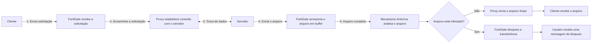

---
tags:
  - fortinet
  - fortigate
  - antivirus
  - security-profiles
  - flow-based
  - proxy-based
---

# Antivírus no FortiGate

## Objetivo

O perfil de **Antivírus (AV)** analisa arquivos e tráfego em busca de códigos maliciosos. O FortiGate utiliza bancos de dados de assinaturas de antivírus, atualizados periodicamente pelos servidores **FortiGuard**.

A proteção depende de alguns fatores:

- Licença de Antivírus do FortiGuard válida e atualizada.
- Perfil de Antivírus configurado e aplicado à política de firewall.
- Modo de inspeção adequado ao cenário.
- Protocolo e porta corretamente incluídos nas opções de protocolo.
- Inspeção SSL profunda, quando o arquivo estiver em tráfego criptografado, como HTTPS.

O Antivírus complementa outros recursos de segurança, como **IPS**, **Web Filter** e **Application Control**. Ele não substitui esses controles.

---

## Modos de inspeção

O FortiGate oferece dois modos principais para inspecionar tráfego:

- **Flow-Based:** prioriza desempenho e encaminha os dados enquanto os analisa.
- **Proxy-Based:** prioriza inspeção e opções adicionais; pode armazenar o arquivo inteiro antes de entregá-lo ao destino.

Ambos utilizam o banco de dados completo de Antivírus, mas diferem na forma de processar o tráfego.

| Característica | Flow-Based | Proxy-Based |
|---|---|---|
| Prioridade | Throughput e desempenho | Inspeção e recursos adicionais |
| Encaminhamento do arquivo | Pode começar antes da análise completa | Aguarda o buffer e a análise do arquivo |
| Detecção de arquivo infectado | Pode ocorrer quando o arquivo está quase totalmente recebido | O arquivo infectado não é entregue ao cliente |
| Uso de recursos | Pode oferecer melhor desempenho e offload | Pode exigir mais buffer e recursos |
| Exemplo de uso | Acesso a servidores confiáveis da empresa | Proteção rigorosa de servidores de e-mail |
| Opções adicionais | Menos opções específicas | Recursos adicionais, como *client comforting* e inspeção por stream |

A disponibilidade e o comportamento exato podem variar conforme a versão do FortiOS e o hardware.

---

## Inspeção Flow-Based

O modo **Flow-Based** analisa o fluxo de dados sem atuar como um proxy completo para a sessão.

### Funcionamento

1. O cliente envia uma solicitação ao servidor.
2. O FortiGate encaminha os pacotes e, ao mesmo tempo, armazena dados em buffer.
3. Quando o arquivo está completo, o mecanismo IPS monta o conteúdo e o envia ao mecanismo Antivírus.
4. Se o arquivo estiver limpo, o FortiGate libera o último pacote armazenado.
5. Se um vírus for detectado, o FortiGate encerra ou reseta a conexão e não envia a parte final do arquivo.

Como o cliente pode ter recebido parte do arquivo antes da detecção, o arquivo fica incompleto ou truncado e normalmente não pode ser utilizado.

O IPS também pode armazenar a URL associada ao arquivo infectado. Se houver uma nova tentativa de transferência do mesmo arquivo, o FortiGate pode apresentar uma mensagem de bloqueio em vez de analisar novamente.

### Métodos de escaneamento Flow-Based

A apostila descreve uma combinação de métodos:

- **Modo padrão:** aprimora a varredura de arquivos compactados aninhados sem armazenar o arquivo compactado inteiro em buffer.
- **Modo legado:** armazena o contêiner compactado inteiro em buffer e só depois o escaneia.

### Características

- O cliente pode começar a receber dados antes do término da análise.
- O FortiGate pode usar aceleração por hardware CP8 ou CP9 para determinadas combinações de padrões.
- É indicado quando o throughput é uma prioridade, desde que o nível de inspeção seja adequado ao risco.

---

## Inspeção Proxy-Based

No modo **Proxy-Based**, o FortiGate atua como proxy e armazena o arquivo em buffer antes de entregá-lo ao cliente.

### Funcionamento

1. O cliente envia uma solicitação.
2. O FortiGate estabelece uma conexão com o servidor.
3. O servidor envia os dados ao FortiGate.
4. O proxy armazena o arquivo completo em buffer.
5. O mecanismo Antivírus analisa o arquivo.
6. Se o arquivo estiver limpo, o proxy o envia ao cliente.
7. Se o arquivo estiver infectado, o FortiGate bloqueia a transferência e pode apresentar uma mensagem ao usuário.

Esse modo oferece uma decisão de segurança antes da entrega do arquivo, mas pode aumentar o tempo de resposta e o consumo de recursos.

### Fluxograma Proxy-Based



### *Client comforting*

Como o FortiGate aguarda o buffer e a análise, o usuário pode perceber demora, desistir da solicitação ou atingir um timeout na conexão.

O **client comforting** pode enviar dados gradualmente ao cliente enquanto o FortiGate termina de armazenar e analisar o arquivo. A apostila indica esse recurso para HTTP e FTP, configurado em `config firewall profile-protocol-options`.

Esse comportamento pode ajudar a reduzir timeouts e melhorar a experiência do usuário. Porém, como parte dos dados pode ser enviada antes da conclusão da análise, a mensagem de bloqueio pode não aparecer da mesma forma na primeira tentativa.

### Inspeção por stream

No modo Proxy-Based, a inspeção por **stream** é habilitada por padrão, conforme a apostila.

Ela permite descompactar, inspecionar e extrair arquivos durante o processamento, em vez de exigir que grandes arquivos compactados sejam mantidos integralmente em memória. Isso ajuda a conservar recursos do FortiGate e permite detectar ameaças que aparecem no meio ou no final de arquivos grandes.

---

## Aplicação do perfil de Antivírus

Para que o Antivírus seja aplicado ao tráfego, configure os elementos necessários:

1. Ative o Antivírus na política de firewall.
2. Selecione um perfil de Antivírus.
3. Escolha o modo de inspeção da política, Flow-Based ou Proxy-Based.
4. Associe as opções de protocolo adequadas.
5. Configure os logs conforme os requisitos de monitoramento.

O perfil só protege o tráfego que corresponde à política e aos protocolos habilitados para inspeção.

### Relação com tráfego criptografado

Para analisar arquivos em tráfego criptografado, como HTTPS, é necessário que o FortiGate consiga inspecionar o conteúdo. Em geral, isso exige **SSL Deep Inspection** e a configuração correspondente do certificado de CA nos dispositivos clientes.

Sem a inspeção profunda, o conteúdo criptografado pode não estar disponível para análise do Antivírus.

Ver também: [[351_Certificados]].

---

## Protocol Options

As **Protocol Options** oferecem controle granular sobre os protocolos analisados pelos perfis de segurança. Podem ser usadas pelo Antivírus e por outros recursos, como:

- Web Filter.
- DNS Filter.
- DLP.
- Outros perfis de segurança compatíveis.

As opções podem incluir:

- Mapeamento de portas para protocolos.
- Configurações comuns.
- Opções específicas para web.
- Opções específicas para e-mail.
- Limites de tamanho e comportamento de arquivos.

Algumas opções, como o mapeamento de portas para protocolos, aplicam-se somente ao modo **Proxy-Based**.

É possível usar o perfil padrão ou criar um perfil personalizado e aplicá-lo à política de firewall.

> Se um serviço utiliza uma porta não padrão, confira se ela está mapeada para o protocolo correto nas Protocol Options. Caso contrário, o tráfego pode não ser inspecionado como esperado.

---

## Arquivos grandes

No perfil padrão, arquivos maiores que o limite configurado podem não ser escaneados.

- O limite padrão citado na apostila é **10 MB**.
- O valor máximo depende do modelo do FortiGate.
- A configuração pela GUI pode aplicar o mesmo comportamento a todos os protocolos.
- Para comportamentos diferentes por protocolo, a alteração pode ser feita via CLI.
- Arquivos acima do limite podem ser registrados em log, se essa opção estiver habilitada.

### Configuração de `oversize-limit`

O resumo original já continha este exemplo:

```bash
config firewall profile-protocol-options
    edit <profile_name>
        config [http | ftp | pop3 | smtp | imap]
            set oversize-limit <MB>
        end
    next
end
```

`<profile_name>` deve ser substituído pelo nome do perfil de opções de protocolo, e `<MB>` pelo limite desejado.

> A sintaxe disponível pode variar conforme a versão do FortiOS e o protocolo. Confirme as opções suportadas pelo equipamento antes de aplicar a configuração.

---

## Arquivos compactados

- O FortiGate pode descompactar arquivos e escanear os arquivos internos separadamente.
- Arquivos compactados protegidos por senha não podem ser descompactados para inspeção.
- Aumentar os limites de tamanho dos arquivos compactados pode elevar o consumo de memória e de recursos do FortiGate.
- Arquivos compactados aninhados podem exigir mais processamento, especialmente quando há vários níveis de compactação.

---

## Logs de Antivírus

Os logs de Antivírus podem ser consultados em:

**Log & Report > Security Events > Antivirus**

Quando um vírus é detectado, o log pode conter:

- Nome do vírus.
- Nome do arquivo.
- Ação executada.
- ID da política.
- Nome do perfil de Antivírus.
- Tipo de detecção.
- URL associada.
- Link para informações adicionais no FortiGuard.

Também é possível habilitar logs para arquivos que excedam o limite de tamanho. Esses registros podem indicar informações como nome do arquivo, URL e a mensagem de que o limite de tamanho foi excedido.

### Logs de tráfego

Os bloqueios do Antivírus também podem aparecer nos logs de tráfego, em **Forward Traffic**. Nos detalhes de um tráfego bloqueado por um perfil de segurança, consulte a aba **Security**.

### Dashboard

O Dashboard de Segurança e seus widgets podem ajudar a acompanhar eventos e acessar detalhes relacionados à proteção.

---

## Licença e atualizações

O FortiGate precisa de uma licença de Antivírus do FortiGuard válida para receber atualizações de assinaturas.

Confira:

- Se a licença está ativa.
- Se o FortiGate consegue acessar a Internet.
- Se a resolução DNS funciona, incluindo para `update.fortinet.net`.
- Se firewalls intermediários permitem a saída TCP 443 para os servidores FortiGuard.
- Se as assinaturas foram atualizadas recentemente.

---

## Troubleshooting

Se o Antivírus não detectar ou não bloquear um arquivo como esperado, verifique:

1. **Licença e atualizações**
   - A licença de Antivírus está válida?
   - O FortiGate consegue atualizar as assinaturas?
   - O DNS e a conexão com os servidores FortiGuard estão funcionando?

2. **Política de firewall**
   - O tráfego corresponde à política correta?
   - O perfil de Antivírus está habilitado e aplicado?
   - O protocolo testado está habilitado no perfil?

3. **Modo e protocolo**
   - O modo de inspeção corresponde ao comportamento esperado?
   - No modo Proxy-Based, as portas estão mapeadas corretamente em Protocol Options?
   - O arquivo está acima do limite configurado?

4. **Tráfego criptografado**
   - O tráfego é HTTPS ou outro protocolo criptografado?
   - Se for, o perfil SSL permite a inspeção necessária?
   - A CA usada para Deep Inspection está instalada como confiável nos dispositivos?

5. **Resultado nos logs**
   - Consulte **Security Events > Antivirus**.
   - Examine os detalhes do evento e os logs de Forward Traffic.
   - Verifique se há logs de arquivos que excederam o limite.

### Comandos úteis

O resumo original já continha estes comandos:

```bash
execute update-av
diagnose debug application update -1
diagnose debug enable
diagnose antivirus test
diagnose autoupdate versions
get system performance status
```

Uso geral:

- `execute update-av` — tenta iniciar uma atualização de Antivírus.
- `diagnose debug application update -1` — exibe mensagens de diagnóstico do processo de atualização.
- `diagnose debug enable` — ativa a saída do debug.
- `diagnose antivirus test` — comando de teste do mecanismo Antivírus, quando suportado pela versão.
- `diagnose autoupdate versions` — mostra informações de versões de componentes e assinaturas.
- `get system performance status` — exibe informações de desempenho do equipamento.

> Os comandos de debug podem gerar muitas mensagens. Depois do diagnóstico, desative a depuração com `diagnose debug disable` e, se necessário, limpe o estado com `diagnose debug reset`. Confirme a disponibilidade e a sintaxe na versão do FortiOS em uso.

---

## Boas práticas

- Mantenha a licença e as assinaturas de Antivírus atualizadas.
- Aplique o perfil de Antivírus às políticas que realmente precisam da inspeção.
- Use Deep Inspection para conteúdo HTTPS quando a análise do conteúdo for necessária e permitida pelas políticas da organização.
- Confira o mapeamento de portas para protocolos não padrão.
- Avalie cuidadosamente os limites de tamanho, pois valores maiores podem aumentar o consumo de recursos.
- Considere o impacto do Proxy-Based em latência, buffer e memória.
- Monitore logs de vírus, arquivos acima do limite e falhas de atualização.
- Teste mudanças em um ambiente controlado antes de aplicá-las amplamente.

---

## Resumo

- O Antivírus do FortiGate usa assinaturas FortiGuard para identificar conteúdo malicioso.
- **Flow-Based** prioriza throughput e pode encaminhar parte do arquivo antes de concluir a análise.
- **Proxy-Based** armazena o arquivo em buffer, analisa e só então libera ou bloqueia a entrega.
- O **client comforting** pode reduzir a percepção de demora em algumas situações, mas altera o comportamento de entrega durante a análise.
- Arquivos grandes podem exceder o limite de inspeção; arquivos compactados protegidos por senha não podem ser descompactados.
- Protocol Options controlam protocolos, portas e limites aplicados aos perfis de segurança.
- Tráfego criptografado pode exigir SSL Deep Inspection.
- Consulte os logs de Antivírus e os logs de tráfego para investigar detecções, bloqueios e arquivos acima do limite.
- Para troubleshooting, verifique licença, atualizações, política, perfil, protocolo, porta, tamanho do arquivo e inspeção SSL.