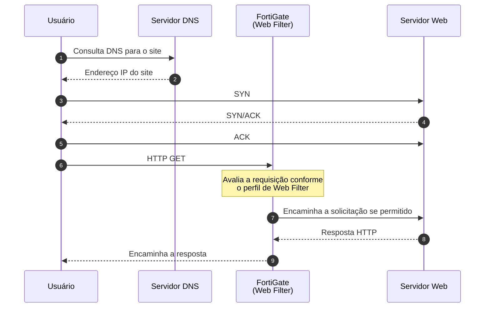
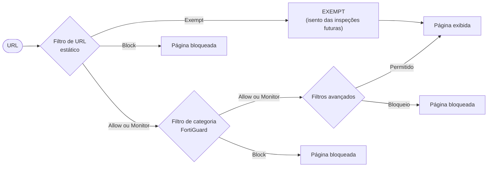

---
tags:
  - fortinet
  - fortigate
  - web-filter
  - fortiguard
  - seguranca
  - firewall
---

# Web Filter no FortiGate

## Objetivo

O **Web Filter** controla e registra o acesso a sites, usando categorias, URLs e outros critérios. Ele pode permitir, bloquear ou monitorar acessos e pode ser aplicado a uma política de firewall.

O Web Filter pode utilizar:

- **Categorias FortiGuard** — classificação de sites mantida pelo serviço FortiGuard.
- **Filtro estático de URL** — regras configuradas localmente para URLs ou domínios específicos.
- **Filtros avançados** — opções adicionais, como Safe Search e bloqueio de determinados conteúdos.
- **Inspeção SSL** — necessária para obter informações de tráfego HTTPS, conforme o nível de inspeção escolhido.

O filtro só atua sobre o tráfego que corresponde à política de firewall e ao perfil de Web Filter aplicado.

---

## Modos de inspeção

O modo de inspeção é definido na política de firewall. O perfil Web Filter aplicado precisa ser compatível com o modo selecionado.

| Característica | Flow-Based | Proxy-Based |
|---|---|---|
| Funcionamento | Examina os pacotes enquanto passam pelo FortiGate | Intercepta e analisa o tráfego como proxy transparente |
| Recursos utilizados | Menor consumo | Maior consumo |
| Velocidade de resposta | Geralmente mais rápida | Pode aumentar a latência |
| Inspeção | Menos opções avançadas | Mais minuciosa e com mais opções |
| Modificação do conteúdo | Recursos que alteram conteúdo podem não estar disponíveis | Pode analisar e modificar cabeçalhos e conteúdo |
| Ações por categoria | Menos opções disponíveis | Suporta opções adicionais, como quotas |
| Exemplo de vantagem | Menor chance de timeout | Maior controle e inspeção |

### Flow-Based

- É o modo padrão indicado na apostila.
- Os pacotes são examinados enquanto atravessam o FortiGate.
- Tende a consumir menos recursos e oferecer resposta mais rápida.
- O tráfego original não é alterado.
- Funções que modificam o conteúdo, como o enforcement de Safe Search, podem não ser suportadas.
- Algumas ações e recursos disponíveis no modo Proxy-Based não existem nesse modo.

### Proxy-Based

- Funciona como um proxy transparente: o FortiGate intercepta o tráfego mesmo que não seja o endereço de destino na camada IP.
- Pode armazenar e analisar o tráfego antes de determinar uma ação.
- Analisa e pode modificar cabeçalhos, como `HTTP Host` e URL.
- Pode apresentar ao usuário uma página específica quando o acesso é bloqueado.
- Oferece recursos adicionais, mas pode aumentar o tempo de resposta e o uso de recursos.

---

## Como o Web Filter processa uma requisição

A apostila demonstra um fluxo HTTP simplificado: após a resolução DNS e o estabelecimento da conexão TCP, a solicitação HTTP passa pelo FortiGate para avaliação do Web Filter.

> Este é um modelo simplificado do fluxo. O ponto exato em que a requisição é inspecionada depende do modo, do protocolo e da configuração da política.



---

## Inspeção SSL e categorização de HTTPS

Para protocolos criptografados, o FortiGate precisa de uma forma de obter informações sobre o site acessado.

### SSL Certificate Inspection

- Não descriptografa o conteúdo do tráfego.
- Inspeciona informações disponíveis no handshake TLS.
- O FortiGate pode obter o FQDN por:
  - **SNI** (*Server Name Indication*) enviado pelo cliente.
  - Campo **CN** do certificado do servidor quando o SNI não está disponível.
- É geralmente suficiente para categorizar sites no Web Filter.
- Não permite a inspeção do conteúdo criptografado da sessão.

### Possível divergência entre SNI e certificado

O SNI e os campos `CN` ou `SAN` do certificado podem não corresponder. A categorização pode, então, usar um nome diferente do esperado e gerar uma liberação ou bloqueio inesperado.

A apostila apresenta três opções para **Server Certificate SNI Check**:

- **Enable:** se o SNI não corresponder a nenhum domínio em `CN` ou `SAN`, o FortiGate usa o domínio do certificado.
- **Strict:** encerra a conexão quando ocorre essa divergência.
- **Disable:** não verifica a correspondência e utiliza o SNI para categorizar a URL.

A opção disponível e seu comportamento podem depender do modo de inspeção e da versão do FortiOS.

---

## Categorias FortiGuard

O FortiGuard classifica sites em categorias. Em vez de criar uma regra individual para cada site, o administrador pode aplicar uma ação a uma categoria inteira.

### Requisitos

- O FortiGate precisa conseguir consultar o serviço de rating do FortiGuard ou uma fonte compatível configurada, como o FortiManager.
- É necessária uma licença ativa de Web Filter para utilizar o serviço de categorização.
- Se ocorrer um erro de rating, o comportamento depende da configuração do perfil.
- A opção **Allow websites when a rating error occurs** define se sites podem ser acessados quando o FortiGate não consegue obter a classificação.

Se essa opção estiver desabilitada e houver falha de rating, as consultas podem ser bloqueadas. Avalie a política de falha de acordo com o nível de segurança desejado.

### Ações por categoria

Cada categoria pode ter uma ação própria. As ações apresentadas na apostila incluem:

| Ação | Comportamento |
|---|---|
| **Block** | Bloqueia o acesso à categoria e pode exibir uma página de bloqueio |
| **Allow** | Permite o acesso sem gerar o registro de monitoramento descrito para `Monitor` |
| **Monitor** | Permite o acesso e registra a atividade |
| **Warning** | Apresenta um aviso antes de permitir que o usuário prossiga |
| **Authenticate** | Solicita autenticação e permite o acesso aos grupos autorizados |

A disponibilidade de algumas ações e opções varia entre Flow-Based e Proxy-Based.

### Warning

- Exibe um aviso antes de liberar o acesso.
- O usuário pode prosseguir conforme a configuração.
- A mensagem pode ser personalizada em **System > Replacement Messages**.
- Pode ser configurado o intervalo de reapresentação do aviso.

### Authenticate

- Solicita que o usuário se autentique para acessar o site.
- É possível definir quais grupos têm permissão.
- Pode ser configurado o intervalo em que a autenticação será solicitada.
- A página de autenticação pode ser personalizada em **System > Replacement Messages**.

### Quotas

- Podem limitar tempo ou volume de tráfego por categoria.
- São disponíveis somente no modo **Proxy-Based**, conforme a apostila.
- Podem ser associadas às ações `Monitor`, `Warning` e `Authenticate`.
- A configuração pode definir quotas diárias por tempo ou tráfego.

---

## Filtro estático de URL

O filtro estático permite criar regras locais para URLs ou domínios, independentemente da classificação de categoria do FortiGuard.

As regras são avaliadas **de cima para baixo (top-down)**. A ordem das entradas pode, portanto, influenciar o resultado.

### Tipos de padrão

| Tipo | Descrição | Exemplo |
|---|---|---|
| **Simple** | Correspondência simples com o texto configurado | `www.sitedeexemplo.com/teste` |
| **Regular Expression** | Usa expressão regular | `.*\algumacoisa\.(org\|biz)` |
| **Wildcard** | Usa caracteres coringa | `*.google.com` |

> A sintaxe exata de expressões regulares pode variar. Teste cuidadosamente os padrões antes de aplicá-los em produção.

### Ações do filtro de URL

| Ação | Comportamento |
|---|---|
| **Exempt** | Permite o tráfego e isenta a URL das inspeções de segurança seguintes |
| **Block** | Bloqueia o acesso e pode apresentar uma página de bloqueio |
| **Allow** | Permite o tráfego, mas ele continua pelas demais verificações do Web Filter e pelos outros perfis de segurança |
| **Monitor** | Permite o tráfego, registra a atividade e mantém as inspeções seguintes |

**Diferença importante:** `Exempt` não é igual a `Allow`. `Exempt` pula as inspeções seguintes; `Allow` permite o tráfego continuar sendo analisado.

### Ordem de inspeção HTTP

A apostila apresenta esta ordem:

1. Filtro estático de URL.
2. Filtro de categoria FortiGuard.
3. Filtros avançados.

Se uma etapa não encontrar correspondência, o FortiGate segue para a próxima. Uma ação de bloqueio encerra o fluxo. A ação `Exempt` isenta a solicitação das inspeções seguintes.



### Observação sobre a ordem

O fluxograma representa a sequência descrita na apostila. A ação final depende da configuração completa do perfil, da política, do modo de inspeção e das demais verificações habilitadas.

---

## Web Rating Override

O **Web Rating Override** altera a categoria atribuída a um site; ele não altera diretamente a ação configurada para uma categoria.

- A URL ou o domínio recebe uma categoria diferente da classificação original.
- A ação configurada para a categoria atribuída passa a ser aplicada.
- A categoria original pode continuar visível para comparação.
- Pode ser útil quando a classificação FortiGuard não representa a política local desejada.

---

## Filtros avançados

Depois das verificações estáticas e de categoria, o FortiGate pode executar filtros adicionais, conforme o perfil e o modo de inspeção.

A apostila cita exemplos como:

- Safe Search.
- Remoção de componentes ActiveX.
- Outras opções de categorização e controle de conteúdo.

Nem todos os filtros avançados estão disponíveis em todos os modos. Alguns recursos que alteram a solicitação ou a resposta podem exigir **Proxy-Based**.

---

## Application Control

O Application Control é um perfil de segurança separado do Web Filter, mas pode ser aplicado na mesma política de firewall.

Pontos presentes no resumo original:

- A estrutura de assinaturas pode ser hierárquica.
- Uma assinatura pai pode ter precedência sobre assinaturas filhas.
- Algumas assinaturas de aplicações exigem inspeção profunda para serem identificadas corretamente.
- No perfil de Application Control, um ícone de cadeado pode indicar a necessidade de inspeção profunda.

A inspeção SSL apropriada pode ser necessária para identificar aplicações que utilizam tráfego criptografado.

---

## Integração com outros perfis e tecnologias

A apostila e o resumo relacionam o Web Filter a outros controles:

- **SSL Inspection:** fornece informações do handshake ou permite inspeção profunda de conteúdo criptografado.
- **Antivirus:** pode analisar arquivos transferidos pela web; para tráfego HTTPS, pode ser necessária Deep Inspection.
- **Application Control:** identifica e controla aplicações.
- **IPsec:** protege o tráfego de rede em túneis VPN; não substitui o Web Filter.
- **DNS Filter:** controla consultas DNS e pode complementar a filtragem de navegação.
- **DLP:** pode inspecionar conteúdo e dados conforme as configurações aplicadas.

Cada perfil tem uma função própria; os controles podem atuar juntos na mesma política.

---

## Logs e monitoramento

Os logs de Web Filter podem ser consultados em:

**Log & Report > Security Events > Web Filter**

Os registros podem apresentar informações como:

- Ação aplicada.
- ID da política.
- Nome do perfil de Web Filter.
- Categoria do site.
- URL ou domínio.
- Tipo de mensagem exibida.
- Informações de quota, quando aplicáveis.

Os logs ajudam a verificar se uma solicitação foi permitida, bloqueada, monitorada ou sujeita a uma ação de autenticação ou aviso.

---

## Troubleshooting do FortiGuard

O FortiGate precisa de conectividade com o FortiGuard para consultar categorias, salvo quando uma fonte alternativa adequada estiver configurada.

### Verificar o status de rating

```bash
diagnose debug rating
```

O comando apresenta informações úteis sobre os servidores de rating.

| Campo | Significado |
|---|---|
| **Weight** | Peso usado na seleção; considera, entre outros fatores, a diferença de fuso horário |
| **RTT** | Tempo de ida e volta da comunicação com o servidor |
| **TZ** | Fuso horário associado ao servidor |
| **FortiGuard-Requests** | Quantidade de requisições enviadas |
| **Curr Lost** | Falhas consecutivas recentes; volta a zero após uma resposta bem-sucedida |
| **Total Lost** | Total acumulado de falhas |
| **D** | Endereço IP do servidor foi resolvido por DNS |
| **I** | Servidor de contrato/licença foi contatado |
| **T** | Servidor não respondeu; permanece nessa condição antes de ser considerado falho |
| **F** | Falha de resposta por período superior ao limite indicado no material |

### Seleção do servidor

O resumo original cita esta lógica geral:

- Diferença de fuso horário contribui para o peso do servidor.
- Perda de pacotes afeta a seleção.
- Se não houver perda, o menor RTT tende a ser preferido.

A seleção efetiva também depende do estado dos servidores e da implementação da versão do FortiOS.

### Transporte e portas

A apostila informa que a comunicação padrão pode usar HTTPS sobre TCP 443. Também apresenta alternativas de configuração com UDP nas portas 443, 53 ou 8888, após desabilitar Anycast.

> Alterar transporte ou porta pode afetar a conectividade com os serviços FortiGuard. Confirme os requisitos da versão e da rede antes da mudança.

### Cache de Web Filter

- O cache reduz consultas repetidas ao FortiGuard.
- A categoria da URL pode ser mantida temporariamente em memória.
- O tempo padrão citado na apostila é **60 minutos**.
- O cache pode ser útil em redes com latência ou banda limitada.
- A configuração é feita em **System > FortiGuard**.

---

## Troubleshooting geral

Se o Web Filter não funcionar como esperado:

1. Confirme que a licença de Web Filter está ativa.
2. Verifique a conexão de rating com:
   ```bash
   diagnose debug rating
   ```
3. Confirme DNS e conectividade do FortiGate com o FortiGuard ou com a fonte de rating configurada.
4. Compare o modo de inspeção da política com o perfil aplicado.
5. Confira se o perfil de Web Filter está ativo na política correta.
6. Revise as ações das categorias e a opção de comportamento diante de erro de rating.
7. Confira a ordem e os padrões do filtro estático de URL.
8. Para HTTPS, confirme que há pelo menos inspeção de certificado quando necessária para categorização.
9. Para recursos que precisam examinar conteúdo criptografado, avalie se Deep Inspection é necessária.
10. Consulte os logs em **Security Events > Web Filter**.

---

## Comandos e conceitos do resumo original

### Diagnóstico de rating

```bash
diagnose debug rating
```

### Leituras úteis

- **RTT** — atraso de ida e volta.
- **TZ** — fuso horário do servidor.
- **Curr Lost** — consultas recentes sem resposta.
- **Total Lost** — histórico total de consultas sem resposta.

### Lógica geral de peso

- Diferença de fuso horário × 10.
- Perda de pacotes.
- Se não houver perda, preferência pelo menor RTT.

---

## Resumo final

- O Web Filter pode filtrar por **URL estática**, categoria FortiGuard e filtros avançados.
- A ordem descrita na apostila é: **URL estática → categoria FortiGuard → filtros avançados**.
- **Exempt** isenta das inspeções seguintes; **Allow** permite o tráfego continuar nas demais inspeções.
- **Flow-Based** prioriza velocidade e usa menos recursos; **Proxy-Based** oferece mais opções e análise mais detalhada.
- Para HTTPS, a **SSL Certificate Inspection** usa SNI ou CN para categorizar, mas não descriptografa o conteúdo.
- **Deep Inspection** pode ser necessária quando os perfis precisam analisar o conteúdo criptografado.
- As quotas de categoria citadas são exclusivas do modo **Proxy-Based**.
- O Web Rating Override muda a categoria do site, não a ação da categoria.
- `diagnose debug rating` ajuda a verificar conectividade e estado dos servidores de rating.
- Os logs de Web Filter mostram a ação, a política, a categoria e a URL associada ao evento.

## Relações com outras notas

- [[321_Firewall_Policy]] — políticas de firewall.
- [[351_Certificados]] — certificados e inspeção SSL.
- [[352_Antivrus]] — inspeção antivírus.
- [[341_Geral]] — autenticação e acesso.